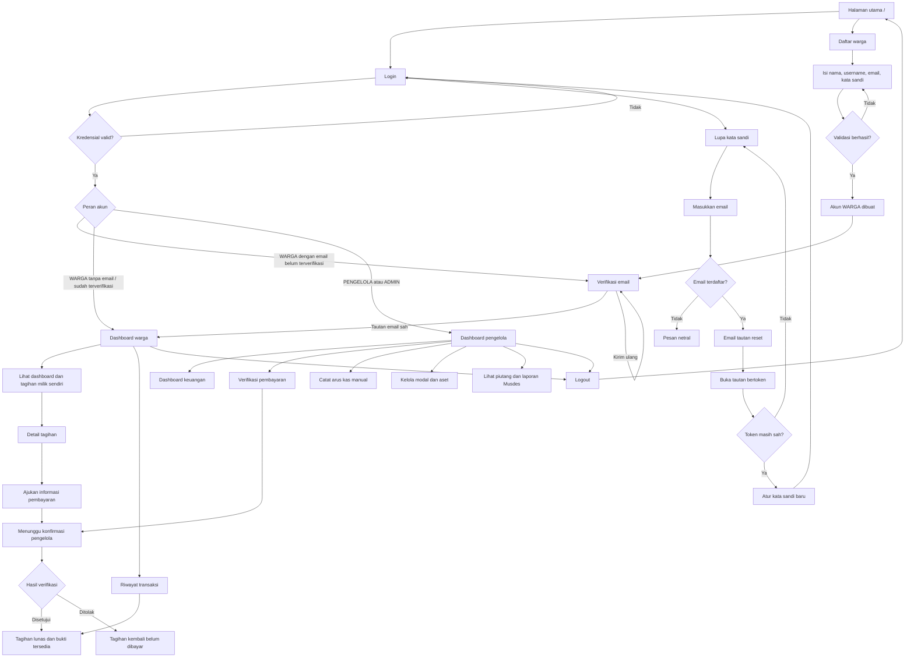

# User Flow Bumcash

Ilustrasi berikut merangkum alur publik, akun warga, dan pengelola sesuai rute aplikasi saat ini.

## Ringkasan alur

- **Pengunjung:** halaman utama → login atau daftar sebagai warga. Registrasi tidak menyediakan pilihan peran.
- **Warga:** verifikasi email jika akun memiliki email → dashboard → detail tagihan → ajukan pembayaran → tunggu verifikasi → lihat status dan bukti pembayaran jika disetujui.
- **Pengelola:** login → dashboard → verifikasi pembayaran, pencatatan kas, pengelolaan modal/aset, piutang, dan laporan.
- **Pemulihan akun:** minta tautan reset lewat email → buka token yang masih berlaku → tetapkan kata sandi baru → login kembali.
- **Sesi:** logout mengakhiri sesi dan kembali ke halaman utama.

> Catatan: role ADMIN mengikuti akses pengelola pada rute saat ini. Akun warga yang tidak memiliki email (misalnya data seeder lama) dapat melewati verifikasi email.
